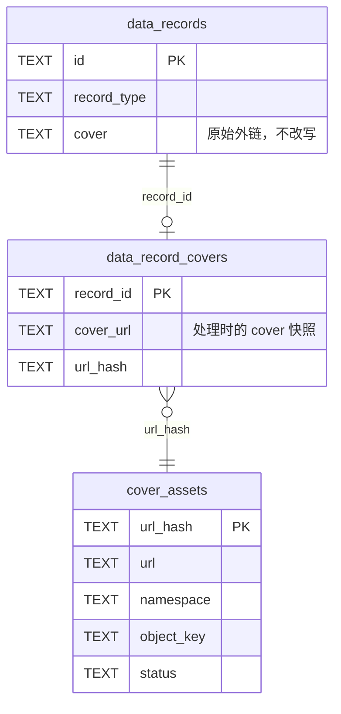
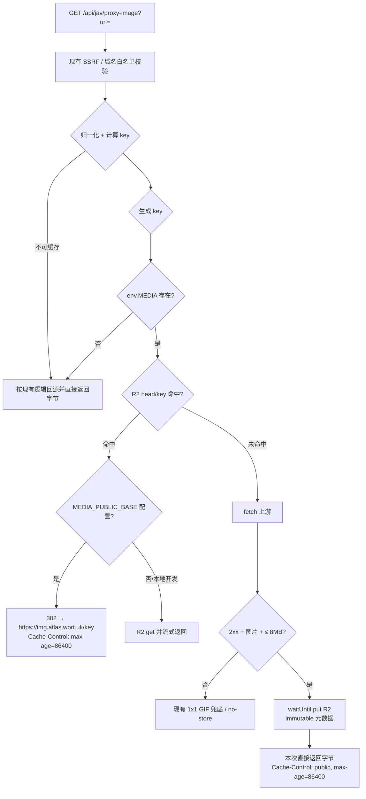

# R2 封面存储集成与迁移方案

> 范围：本地库 `data_records`（含 jav / anime / movie / manga / novel / actress）的封面。
> 目标：把「每次看图都回源原站」改成「第一次取回后永久从 R2 + CDN 出图」，
> 同时建立可查询、可重建、可回滚的封面-数据库对照关系。
> 本文只描述方案，不改代码；实施时按第 8 节顺序执行。

---

## 0. 一页结论

| 决策 | 内容 |
| --- | --- |
| R2 的定位 | **封面的可重复缓存层**，不是新的事实源。D1 仍是唯一业务数据库。 |
| `data_records.cover` | **不改写**，继续存原始外链。前端、API、搜索链路零改动。 |
| 取图方式 | 代理接口命中 R2 后 `302` 到 `https://img.atlas.wort.uk/...`，由 CDN 出图，不再经过 Worker 传图片字节。 |
| 对象 key | **URL 的纯函数**：`covers/v1/orig/<namespace>/<hash前2位>/<sha256>`。运行时不需要查 D1。 |
| 数据库对照 | `cover_assets`（URL ↔ R2 对象）+ `data_record_covers`（记录 ↔ 封面处理状态）。只做账本，不参与取图。 |
| 历史数据迁移 | 双轨：访问时懒加载 + 后台按「新到旧」回填。可随时暂停，幂等可重跑。 |
| 回滚 | 移除绑定或还原代码即可；D1 外链未变，R2 对象只是闲置，无数据损失。 |

核心不变式：

```
objectKey = objectKeyFor(normalize(url))
```

只要这个函数不变，R2 里的对象即使数据库丢了也能重新对应；反过来，数据库里的
映射表丢了也不影响取图。这是整个方案可回滚、可重建的基础。

---

## 1. 现状与约束

### 1.1 现状证据

- 图片代理：[backend/src/routes/jav.ts](../backend/src/routes/jav.ts#L117-L261)
  每次请求都在 Worker 内 `fetch` 上游图片，读完 `arrayBuffer` 再回给浏览器。
- Worker 生成的响应带 `Cache-Control` **不会自动进入 Cloudflare CDN**，
  只有 `caches.default` 显式写入或静态资源才会被边缘缓存；该路由没有写 Cache API。
  结果：每一次页面渲染、每一个用户，都会重新打上游。
- 封面散落在多张表：

  | 表 / 字段 | 用途 | 是否纳入本次迁移 |
  | --- | --- | --- |
  | `data_records.cover` | 本地库封面 | **是** |
  | `jav_ranking_entries.cover` | 榜单快照当时的封面 | 否（懒加载覆盖） |
  | `user_favorites.cover` / `user_search_history.cover` | 用户侧快照 | 否（懒加载覆盖） |
  | `community_posts.cover_image` | 社区帖封面 | 否（懒加载覆盖） |
  | `follows` / 通知里的 `cover` | 关注动态快照 | 否（懒加载覆盖） |

- 允许代理的封面来源（见 `ALLOWED_IMAGE_HOSTS`）已经覆盖 6 类内容，
  可以直接用于 namespace 判定。
- 部署方式：Cloudflare Workers Builds 连接 GitHub，push 自动部署；
  `backend/wrangler.toml` 里新增 R2 绑定后，**bucket 必须先存在**，否则部署失败。

### 1.2 约束

1. 不改 `data_records.cover` 的语义，不把 R2 URL 写回数据库。
2. 不改变前端 `getProxyImageUrl()` 的调用方式：所有页面仍请求代理接口。
3. 图片代理是无鉴权路由，不能引入每张图一次 D1 写入。
4. 上游有反爬/限流（JavBus、JavDB），回填必须限速，不能并发打满。
5. 现有 `jav-detail-job` 每分钟也在抓 JavBus，回填要与之串行，避免叠加突发。

---

## 2. 设计原则

1. **URL 是主键，记录不是。** 同一张封面被多条记录引用时只存一份对象。
2. **key 确定性。** 由 URL 直接算出，命中判断不需要任何数据库查询。
3. **账本与内容分离。** `data_records.cover` 是业务事实；`cover_assets` 是缓存账本；
   两者通过 URL 关联，账本可整表重建。
4. **懒加载兜底。** 未被回填的图片，第一次被访问时自动入 R2，不依赖迁移完成。
5. **失败不劣化。** R2 不可用、写入失败、上游失败时，行为与现在完全一致。

---

## 3. R2 目录结构

### 3.1 Bucket

```
atlas-media
```

### 3.2 对象 key

```
covers/v1/orig/<namespace>/<hash[0:2]>/<sha256>
```

示例：

```
covers/v1/orig/jav/9f/9f2c1d...e1
covers/v1/orig/anime/0a/0a77b3...c4
covers/v1/orig/person/3d/3d90aa...72
```

设计理由：

| 设计 | 原因 |
| --- | --- |
| `covers/` | 桶内以后可能放头像、社区附件，先分顶层。 |
| `v1/` | 以后换 key 规则（压缩、WebP、多尺寸）时用 `v2/`，不覆盖旧对象。 |
| `orig/` | 预留 `w400/`、`webp/` 等派生版本的位置，本次不做。 |
| `<namespace>/` | 人肉浏览和按类统计方便；**只用于组织，不参与取图逻辑**。 |
| `<hash[0:2]>/` | 256 个分片，避免单前缀对象过多，R2 控制台和 list 都更好用。 |
| `<sha256>` | 64 位小写十六进制，URL 的唯一指纹。 |
| 无扩展名 | Content-Type 由对象元数据决定；避免 `.jpg/.png` 判定错误导致 key 不唯一。 |

### 3.3 namespace 判定

namespace 由 **URL host** 决定，保证代理与回填算出同一个 key：

| namespace | host |
| --- | --- |
| `jav` | `javbus.com`、`www.javbus.com`、`pics.javbus.com`、`img.javbus.com`、`javdb.com`、`*.javdb.com`、`jdbstatic.com`、`*.jdbstatic.com`、`tp.spfcas.com` |
| `anime` | `lain.bgm.tv` |
| `movie` | `image.tmdb.org` |
| `manga` | `uploads.mangadex.org` |
| `novel` | `annas-archive.gl/.pk/.gd`、`zh.annas-archive.*`、`covers.z-lib.*`、`covers1.z-lib.*` |
| `person` | `www.minnano-av.com` |
| `misc` | 其余允许的 host（如 `www.xqishuta.org`） |

不变式：**host → namespace 的映射只增不改**。已有 host 不允许改分类，
否则同一 URL 会算出两个 key，产生重复对象。

### 3.4 对象元数据

写入 R2 时设置：

```ts
{
  httpMetadata: {
    contentType: 'image/jpeg',                       // 嗅探或上游值
    cacheControl: 'public, max-age=31536000, immutable',
  },
  customMetadata: {
    srcHost: 'www.javbus.com',
    storedAt: '1730000000000',
  },
}
```

不在 R2 元数据里存完整原 URL（JavDB 的 URL 带令牌，且元数据有大小限制）；
完整 URL 存在 `cover_assets.url`。

---

## 4. 数据库设计

### 4.1 新增表

```sql
-- database/16_cover_assets.sql

CREATE TABLE IF NOT EXISTS cover_assets (
    url_hash      TEXT PRIMARY KEY,              -- sha256(归一化 URL)，64 位小写 hex
    url           TEXT NOT NULL,                 -- 归一化后的完整地址（审计 / 重建）
    namespace     TEXT NOT NULL,                 -- jav/anime/movie/manga/novel/person/misc
    object_key    TEXT NOT NULL UNIQUE,          -- covers/v1/orig/<ns>/<h2>/<hash>
    status        TEXT NOT NULL DEFAULT 'ready'
                  CHECK (status IN ('ready', 'missing', 'failed')),
    mime_type     TEXT,
    byte_size     INTEGER,
    source_host   TEXT,
    attempts      INTEGER NOT NULL DEFAULT 0,
    retry_exhausted INTEGER NOT NULL DEFAULT 0,
    last_error    TEXT,
    next_retry_at INTEGER NOT NULL DEFAULT 0,
    first_seen_at INTEGER NOT NULL,
    stored_at     INTEGER
);

CREATE INDEX IF NOT EXISTS idx_cover_assets_retry
  ON cover_assets(status, retry_exhausted, next_retry_at);

CREATE INDEX IF NOT EXISTS idx_cover_assets_host
  ON cover_assets(source_host);

-- 每条本地库记录对应一行：记录「这条记录处理过哪个封面 URL」
CREATE TABLE IF NOT EXISTS data_record_covers (
    record_id  TEXT PRIMARY KEY,
    cover_url  TEXT NOT NULL,                    -- 处理时的 data_records.cover 快照
    url_hash   TEXT NOT NULL,
    updated_at INTEGER NOT NULL,
    FOREIGN KEY (record_id) REFERENCES data_records(id) ON DELETE CASCADE
);

CREATE INDEX IF NOT EXISTS idx_data_record_covers_hash
  ON data_record_covers(url_hash);

-- 回填按「最近更新优先」扫描，加一个部分索引避免全表排序
-- 谓词与候选查询保持一致，SQLite 才会命中该索引
CREATE INDEX IF NOT EXISTS idx_data_records_cover_updated
  ON data_records(last_updated_at DESC)
  WHERE cover IS NOT NULL AND trim(cover) <> '';
```

### 4.2 三张表的关系



三层含义必须分清：

1. **业务层**：`data_records.cover` 是唯一业务事实，API 和前端继续读它。
2. **映射层**：`cover_assets` 把「URL 指纹」映射到「R2 对象」。
   同一张图被 10 条记录引用时，这里只有 1 行。
3. **归属层**：`data_record_covers` 记录「这条记录处理过哪个 cover」，
   用于精确统计缺口、增量回填、检测 cover 变更。它**不参与运行时取图**。

### 4.3 关键查询

回填候选（新增 / cover 变更）：

```sql
SELECT d.id, d.record_type, d.cover
FROM data_records d
LEFT JOIN data_record_covers c ON c.record_id = d.id
WHERE d.cover IS NOT NULL AND trim(d.cover) <> ''
  AND (c.record_id IS NULL OR c.cover_url <> d.cover)
ORDER BY d.last_updated_at DESC
LIMIT ?;
```

失败重试：

```sql
-- failed：按退避重试；missing：源站 404/410，30 天后才再试一次
SELECT url_hash, url, namespace, object_key, attempts
FROM cover_assets
WHERE status IN ('failed', 'missing')
  AND retry_exhausted = 0
  AND next_retry_at <= ?
ORDER BY next_retry_at ASC
LIMIT ?;
```

覆盖率：

> 懒加载不写账本（避免每张图一次 D1 写），因此覆盖率只反映**回填进度**，
> 会小于 R2 中实际对象数。这是预期行为。

```sql
SELECT
  COUNT(*) AS total_with_cover,
  SUM(CASE WHEN a.status = 'ready' THEN 1 ELSE 0 END) AS ready,
  SUM(CASE WHEN a.status = 'missing' THEN 1 ELSE 0 END) AS missing,
  SUM(CASE WHEN a.status = 'failed' THEN 1 ELSE 0 END) AS failed
FROM data_records d
LEFT JOIN data_record_covers c ON c.record_id = d.id
LEFT JOIN cover_assets a ON a.url_hash = c.url_hash
WHERE d.cover IS NOT NULL AND trim(d.cover) <> '';
```

单条记录反查对象：

```sql
SELECT d.id, d.title, d.cover, c.url_hash, a.object_key, a.status
FROM data_records d
LEFT JOIN data_record_covers c ON c.record_id = d.id
LEFT JOIN cover_assets a ON a.url_hash = c.url_hash
WHERE d.id = ?;
```

> 孤儿对象清理（本次不自动执行）：以 `data_record_covers` 为准会误删
> 「只被懒加载、没有账本」的搜索封面，因此清理必须基于 R2 list + 人工确认，
> 见 12 节「不做」。

### 4.4 一条记录的实际走向

以 `jav:ABC-123` 为例：

```
data_records
  id          = rec_01
  record_type = jav
  cover       = https://www.javbus.com/pics/cover/abc.jpg

归一化 URL      = https://www.javbus.com/pics/cover/abc.jpg
url_hash        = 9f2c1d...e1            -- sha256
namespace       = jav                    -- host 决定
object_key      = covers/v1/orig/jav/9f/9f2c1d...e1

cover_assets
  url_hash    = 9f2c1d...e1
  url         = https://www.javbus.com/pics/cover/abc.jpg
  namespace   = jav
  object_key  = covers/v1/orig/jav/9f/9f2c1d...e1
  status      = ready
  byte_size   = 84213
  mime_type   = image/jpeg

data_record_covers
  record_id   = rec_01
  cover_url   = https://www.javbus.com/pics/cover/abc.jpg
  url_hash    = 9f2c1d...e1

浏览器请求
  /api/jav/proxy-image?url=https%3A%2F%2Fwww.javbus.com%2Fpics%2Fcover%2Fabc.jpg
  → 302
  → https://img.atlas.wort.uk/covers/v1/orig/jav/9f/9f2c1d...e1
```

注意：`content_data` JSON 里可能也有一份 `cover` 副本，那是采集快照，
本次不处理；即使被展示，代理也会按同一套 lazy 逻辑缓存。

---

## 5. URL 归一化

归一化是 key 的唯一输入，必须由代理和回填共用同一个函数
（建议 `backend/src/services/media-key.ts`）。

规则顺序：

1. `trim()`，空值返回 `null`。
2. 已是代理 URL（含 `?url=`）：取出内层原始地址再继续。
3. `//host/path` 补 `https:`。
4. `&amp;` → `&`（抓取 HTML 常见）。
5. JavDB 令牌 CDN 归一化：`tp.spfcas.com/<token>/covers/...`
   → `c0.jdbstatic.com/covers/...`（复用现有
   [javdb-cover.ts](../backend/src/services/javdb-cover.ts) 的逻辑）。
6. 删除 fragment（`#...`）。
7. scheme / hostname 小写（path、query 保持原样）。
8. 只接受 `http:` / `https:`；相对路径、`data:`、`blob:` 返回 `null`。
9. **不删 query 参数**：很多图床的签名参数在 query 里，删了会 403。

哈希：

```
url_hash = SHA-256(UTF-8(归一化 URL)) 的小写 hex
```

---

## 6. 运行时读写

### 6.1 图片代理流程



关键点：

- **命中才 302**。首次未命中的用户直接拿到字节，不额外付一次重定向 RTT；
  `waitUntil` 异步写 R2，不阻塞响应。
- 302 带 `Cache-Control: public, max-age=86400`，浏览器会缓存这个跳转，
  之后同一张图直接打 R2/CDN，Worker 请求量趋近于「每个 URL 每天每浏览器一次」。
- `MEDIA_PUBLIC_BASE` 配在生产 vars；本地 `.dev.vars` 设置
  `APP_ENV=development`，`coverPublicUrl()` 会返回 null，自动退化为
  「从本地 R2 模拟器读字节」，不会跳到生产域名。
- 失败（超时、403、非图片、超过 8MB）**不写 R2**，保持现有 1x1 GIF 行为，
  避免把错误永久固化。
- 现有 SSRF 校验、host 白名单、Referer 映射全部保留，顺序不变。

### 6.2 为什么不在 API 响应里直接返回 R2 URL

前端 `normalizeImageUrl()` 会把任何 `http` 开头的 URL 重新包成代理 URL。
一旦 API 返回 `img.atlas.wort.uk` 的地址，会被二次代理，形成递归/无效请求。
302 方案只改代理一处，所有页面（本地库、收藏、历史、社区、榜单、通知）
自动生效，是迁移成本最低的路径。

### 6.3 新数据写入

- 搜索、详情、榜单写入 D1 时**不做同步 R2 写入**，避免主链路多一次外部请求。
- 新记录由「懒加载」在首次展示时入 R2；后台回填任务会补齐没被访问到的记录。
- 详情补全更新 `data_records.cover` 后，回填任务通过
  `data_record_covers.cover_url <> data_records.cover` 自动发现并重跑该记录。

---

## 7. 历史数据迁移

### 7.1 双轨策略

| 轨道 | 触发 | 覆盖 | 作用 |
| --- | --- | --- | --- |
| 懒加载 | 用户访问 | 所有被看过的封面（含搜索/社区/收藏） | 立即止血，热点内容零配置迁移 |
| 后台回填 | 每分钟 cron | 本地库全部有 cover 的记录 | 归档兜底，保证源站挂了也能出图 |

### 7.2 回填任务

新增 `backend/src/services/cover-backfill.ts`，复用
`jav-detail-job` 的暂停/进度/限速思路，但不新建任务表：

- 开关：系统配置 `cover_backfill_enabled`（管理端「封面管理」页可随时暂停/继续）。
- 批次：默认 20 条/分钟（可配），单次 cron 内串行执行。
- 并发：最多 4 个上游请求同时打开（Workers 单次调用连接数上限是 6）。
- 限速：按 host 分别控制间隔（见下表）。
- 幂等：先 `MEDIA.head(key)`。对象已存在（之前懒加载过）时不重复下载，
  直接用 head 的 size/contentType 写账本。
- 写账本顺序：
  - 成功：**先 R2 put，再写 `cover_assets.status='ready'` + `data_record_covers`**；
  - 失败：不写 R2，只写 `cover_assets.status='failed'|'missing'` + `data_record_covers`。
  任何时候都不会出现「账本 ready 但对象不存在」。
- 与 `jav-detail-job` 串行：在 `* * * * *` 的 `waitUntil` 链里排在详情任务之后，
  避免同一分钟同时对 JavBus 发起两拨请求。

上游限速建议：

| host | 最小间隔 |
| --- | --- |
| `javbus.com` / `pics.javbus.com` / `img.javbus.com` | 500ms |
| `javdb.com` / `*.jdbstatic.com` / `tp.spfcas.com` | 500ms |
| `lain.bgm.tv` | 200ms |
| `image.tmdb.org` | 100ms |
| `uploads.mangadex.org` | 200ms |
| Anna's Archive / z-lib 系列 | 500ms |
| `www.minnano-av.com` | 500ms |

失败分类与退避（与 `jav_detail_meta` 语义保持一致）：

| 上游结果 | 状态 | 退避 |
| --- | --- | --- |
| 2xx 且是图片 | `ready` | — |
| 404 / 410 | `missing` | 30 天后可重试一次（源站可能补图） |
| 403 / 429 / 5xx / 超时 / 网络错误 | `failed` | 1h → 6h → 24h → 3d → 放弃（`retry_exhausted=1`） |
| 图片 > 8MB 或非图片 | `failed` | 不自动重试（`retry_exhausted=1`） |

### 7.3 回填顺序

按 `data_records.last_updated_at DESC`：最近更新/新入库的优先。
理由：老记录被访问概率低，懒加载会自然覆盖；先把「现在会被看到」的补齐，
即使迁移中途停止，线上体验也是完整的。

### 7.4 迁移前摸底（生产库执行，只读）

```sql
SELECT record_type,
       COUNT(*) AS total,
       SUM(CASE WHEN cover IS NULL OR trim(cover) = '' THEN 1 ELSE 0 END) AS no_cover,
       COUNT(DISTINCT cover) AS distinct_cover
FROM data_records
GROUP BY record_type;
```

再用一次性 Node 脚本检查 `DISTINCT cover` 的：

- host 分布（估算每类限速压力）
- 非 `http(s)` 值、代理 URL 形态、超长 URL
- 重复引用（同一封面被多少条记录使用，决定对象去重收益）

脚本只读，不写库；结果用于确认容量和是否需要调整批次大小。

### 7.5 容量与耗时（按 20 条/分钟）

| 有封面的记录数 | 对象数（按去重后 90% 估） | 回填时长 | 存储（按 120KB/张） |
| --- | --- | --- | --- |
| 1 万 | ~9 千 | ~8 小时 | ~1.1 GB |
| 10 万 | ~9 万 | ~3.5 天 | ~11 GB |
| 50 万 | ~45 万 | ~17 天 | ~54 GB |

数据量以 7.4 的实测为准；批次大小可随时调，不影响正确性。

### 7.6 大批量时的加速选项

如果实测「有封面的记录」超过 10 万，20 条/分钟偏慢。此时可以先用一次性
Node 脚本（`scripts/` 下）跑首轮，Worker cron 只做后续增量：

- 脚本共用 `media-key.ts` 的归一化和 key 逻辑，保证与线上一致。
- 图片写入走 R2 S3 API，账本写入走 D1 HTTP API；两者都需要额外 token。
- 仍需按 host 限速（单机出口 IP 更容易被 JavBus 封，建议比线上更保守）。
- 脚本必须支持断点：账本已 `ready` 的 URL 直接跳过，可随时中断重跑。
- 首轮跑完后，线上回填开关只处理新增/变更记录，压力接近零。

如果实测只有几千到几万条，直接用 Worker 回填即可，不建议引入本地脚本和额外密钥。

---

## 8. 实施步骤与改动清单

### 8.1 顺序（不可颠倒）

1. **创建 R2 bucket** `atlas-media`（否则下一步部署失败）。
2. 绑定自定义域 `img.atlas.wort.uk`，等待证书生效。
3. 给 `img.atlas.wort.uk/*` 加 Cache Rule：Eligible for cache，Edge TTL 1 年。
4. 手动执行 `database/16_cover_assets.sql`（项目约定：数据库脚本手动执行）。
5. 合并代码，Workers Builds 自动部署。
6. 冒烟验证（见第 9 节）。
7. 在管理端「封面管理」页打开回填开关，观察 24 小时。

### 8.2 文件级改动

| 文件 | 改动 |
| --- | --- |
| `database/16_cover_assets.sql` | 新建两张表 + 索引（DDL 见 4.1） |
| `backend/src/services/media-key.ts` | 新增：URL 归一化、namespace、sha256、objectKey |
| `backend/src/services/media-store.ts` | 新增：R2 head/get/put、Content-Type 嗅探、8MB 上限、元数据 |
| `backend/src/services/cover-backfill.ts` | 新增：候选查询、批次执行、限速、退避、统计 |
| `backend/src/routes/jav.ts` | 代理路由接入 media-store；保留原有校验与兜底 |
| `backend/src/routes/data-storage.ts` | 管理端新增封面覆盖率统计、回填开关 |
| `backend/src/index.ts` | `* * * * *` cron 中串行追加回填批次 |
| `backend/src/types/index.ts` | `Env` 增加 `MEDIA?: R2Bucket`、`MEDIA_PUBLIC_BASE?: string` |
| `backend/wrangler.toml` | 新增 `[[r2_buckets]]`；`[vars]` 增加 `MEDIA_PUBLIC_BASE` |
| `backend/src/services/__tests__/media-key.test.ts` | 归一化与 key 确定性测试 |
| 前端 | **无改动**（仍走 `getProxyImageUrl`） |

### 8.3 配置样例

```toml
# backend/wrangler.toml
[[r2_buckets]]
binding = "MEDIA"
bucket_name = "atlas-media"
# wrangler dev --remote 时才需要
# preview_bucket_name = "atlas-media-preview"

[vars]
MEDIA_PUBLIC_BASE = "https://img.atlas.wort.uk"
```

`MEDIA_PUBLIC_BASE` + `APP_ENV` 是本方案的「开关」：

- 生产配置 `MEDIA_PUBLIC_BASE` → 命中返回 302，走 CDN。
- 本地开发 `APP_ENV=development` → 命中从 R2 读字节直接返回。
- `MEDIA` 绑定缺失 → 完全退回当前行为。

---

## 9. 验收清单

冒烟（生产域）：

```bash
# 1. 第一次：未命中，返回图片字节
curl -s -o /dev/null -D - "https://atlas.wort.uk/api/jav/proxy-image?url=https%3A%2F%2Fwww.javbus.com%2Fpics%2Fcover%2Fxxx.jpg"

# 2. 第二次：命中，返回 302
curl -s -o /dev/null -D - "https://atlas.wort.uk/api/jav/proxy-image?url=https%3A%2F%2Fwww.javbus.com%2Fpics%2Fcover%2Fxxx.jpg"

# 3. 直接访问 R2 公网地址：200 + immutable + 第二次 HIT
curl -s -o /dev/null -D - "https://img.atlas.wort.uk/covers/v1/orig/jav/xx/<hash>"
```

必须确认：

- [ ] 命中返回 `302`，`Location` 指向 `img.atlas.wort.uk`。
- [ ] R2 对象 `Content-Type: image/*`，`Cache-Control` 含 `immutable`。
- [ ] 第二次请求 `cf-cache-status: HIT`（证明 Cache Rule 生效）。
      若一直是 `MISS`，检查 Cache Rule 是否覆盖 `img.atlas.wort.uk/*`：
      R2 自定义域不会自动套用 `/api/*` 的缓存规则，必须单独匹配 host。
- [ ] `cover_assets.status='ready'`，`data_record_covers` 有对应行。
- [ ] 回填开关打开后，覆盖率单调上升；关闭后批次立即停止。
- [ ] 上游 403 / 超时场景仍返回 1x1 GIF，页面不出现裂图。
- [ ] 本地库、收藏、搜索历史、社区、榜单页封面显示无变化。
- [ ] `wrangler dev` 本地能正常出图（不依赖生产域名）。
- [ ] 后端 `typecheck` / `lint` / `build` 通过；前端 `build` 通过。

---

## 10. 回滚

按代价从低到高：

1. **只停回填**：管理端关闭开关，运行时懒加载继续工作。
2. **停用 302**：删除 `MEDIA_PUBLIC_BASE` 后重新部署，命中改为直出字节。
3. **完全回退**：移除 `[[r2_buckets]]` 绑定并部署上一版本。
   代理走「未命中」分支，行为与现在一致。
4. **数据层**：`cover_assets` / `data_record_covers` 是新增表，可保留不动；
   R2 对象只是闲置，不影响任何读取。
5. **无需恢复 `data_records`**：`cover` 从未被改写。

> 注意：不要为了「回滚方便」在 R2 里做可写覆盖。对象一旦写入即视为不可变，
> 这也是能安全使用一年缓存的前提。

---

## 11. 成本估算

假设：平均 120KB/张，去重后对象数 ≈ 有封面记录数 × 0.9。

| 规模 | R2 存储 | 一次性 Class A 写入 | 月存储费（$0.015/GB） |
| --- | --- | --- | --- |
| 1 万 | ~1.1 GB | ~9 千次 | ~$0.02 |
| 10 万 | ~11 GB | ~9 万次 | ~$0.17 |
| 50 万 | ~54 GB | ~45 万次 | ~$0.81 |

- R2 出网流量费用为 0；图片由 CDN 出，回源只发生在边缘未缓存时。
- Class B（读）只在边缘 miss 时产生，量级远低于页面请求。
- D1：每张图一次性 2 行写入（`cover_assets` + `data_record_covers`），
  10 万张约 20 万行，属于一次性开销；日常只有新增记录产生写入。
- 以上为公开单价估算，最终以 Cloudflare 账单为准；
  真正的变量是「有封面记录数 × 平均图片大小」，以 7.4 实测为准。

---

## 12. 明确不做

| 不做 | 原因 |
| --- | --- |
| 把 `data_records.cover` 改成 R2 URL | 会产生第二个事实源；前端 `normalizeImageUrl` 会二次代理；回滚困难。 |
| 把收藏 / 历史 / 社区 / 榜单快照纳入账本 | 代理懒加载已经覆盖；这些是用户侧快照，规模大、收益低。后续需要时复用同一张 `cover_assets` 即可。 |
| 自动 GC 孤儿对象 | 懒加载产生的对象没有账本记录，自动清理会误删。先观察 3 个月，用 R2 list + 人工确认的方式处理。 |
| 图片压缩 / 转 WebP / 多尺寸 | 需要 Image Resizing 或 Images，按张计费；本次只做「原图缓存」，`v1/orig/` 已预留派生版本位置。 |
| 用 Worker 路由 `/media/*` 代替自定义域 | Worker 每次都要执行并转发字节；自定义域由 CDN 直接出图，成本和延迟都更低。 |
| 暴露 `r2.dev` 公网域名 | 有速率限制，不适合生产流量。 |
| 用 Queues 跑回填 | 当前 20 条/分钟的规模，cron + D1 账本足够；等抓取量或失败重试成为瓶颈再迁移。 |
| 在代理热路径写 D1 | 每张图一次写入会放大 D1 写压力；账本只由回填任务写。 |
| 存用户上传图片 | 当前没有上传功能，桶只存公开封面。 |

---

## 13. 待确认

1. **公网域名**：默认 `img.atlas.wort.uk`，需要 `wort.uk` 的 DNS 控制权；
   如果不想新增子域，可改用 Worker 路由 `/media/*`（代价是每张图仍经过 Worker）。
2. **回填范围**：默认「本地库全部有封面的记录、按新到旧、20 条/分钟、可暂停」。
   如果只想先覆盖近期数据，可把候选查询加时间窗（如 `last_updated_at > now-180d`）。
3. **批次速度**：默认 20 条/分钟；调高会加快回填，但增加上游 403 风险。
